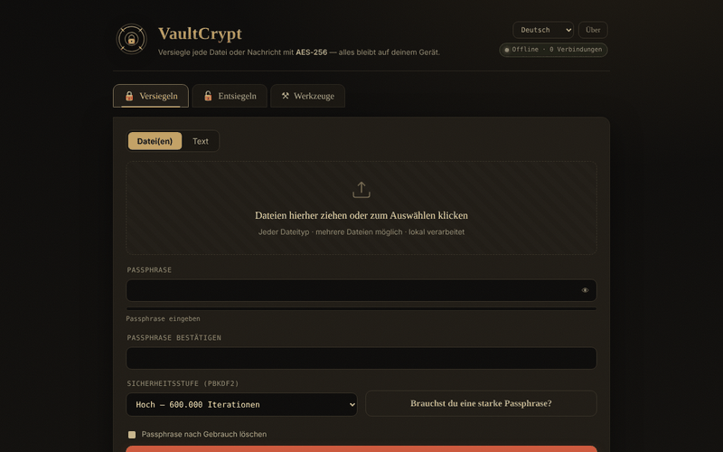

# VaultCrypt

[English](README.md) · [Română](README.ro.md) · [Français](README.fr.md) · [Italiano](README.it.md) · [Español](README.es.md) · [Português](README.pt.md) · **Deutsch** · [Magyar](README.hu.md)

**Version:** 2.2.0 · **Zuletzt aktualisiert:** 2026-10-19

Oberflächensprachen: **Română, English, Français, Italiano, Español, Português (PT), Deutsch, Magyar**

**Online / Demo:** https://chiuta.github.io/VaultCrypt/

Ver- und Entschlüsselung von Dateien und Text im Browser, in einer einzigen `index.html` (8 Sprachen), dazu ein Passwortgenerator und Prüfsummen.

## So funktioniert es (laut Code)
- Schlüsselableitung aus dem Passwort mit PBKDF2-HMAC-SHA-256 (310.000 / 600.000 / 1.000.000 Iterationen; Standard „High“ = 600.000; die beim Versiegeln zuletzt verwendete Stufe wird lokal in `localStorage` gespeichert, Schlüssel `vaultcrypt.sec`), zufälliger 16-Byte-Salt.
- AES-256-GCM-Verschlüsselung (Web Crypto) mit zufälligem 12-Byte-IV; der Container-Header (39 Byte) wird als zusätzliche Daten authentifiziert.
- Format `.vault` (Magic `VCRYPT`, Version 1/2) oder ein textuell „gepanzerter“ (armored) Block für Nachrichten.
- Generierte Passwörter verwenden `crypto.getRandomValues`. Prüfsummen: SHA-256/384/512 und SHA-1 (SHA-1 ist schwach; nur zur Integritätsprüfung von Dateien, nicht für Sicherheitszwecke).

## Warnhinweise
- **Nicht unabhängig geprüft.** Code eines einzelnen Autors, ohne externes Sicherheitsaudit; verwende ihn nicht als einzigen Schutz für kritische Daten.
- **Passwort verloren = Daten verloren.** Es gibt keine Wiederherstellung. Bewahre Sicherungskopien und das Passwort an einem sicheren Ort auf.
- Das Passwort bleibt für die Dauer der Sitzung im Speicher des Browsers; ein kompromittiertes Gerät (Malware, Erweiterungen) hebelt den Schutz aus.

## Daten und Datenschutz
Keine Netzwerkanfragen: Die Seite hat eine CSP mit `connect-src 'self'`, und `fetch`/`XMLHttpRequest`/`sendBeacon` sind im Code blockiert („Privacy audit“-Protokoll in der Seite). Keine Telemetrie, keine externen Schriftarten oder Skripte. Beim Audit geprüft: 0 externe Anfragen beim Laden. Die einzigen externen Links befinden sich in der Fußzeile und im Fenster „Über“ (sie öffnen sich nur per Klick).

## Einschränkungen
Dateien werden vollständig in den Speicher gelesen (beim Verschlüsseln mehrfach): praktische Grenze 400 MB pro Vorgang (getestet: 380 MB in Ordnung, ≈860 MB blockiert den Tab). Verwende für größere Dateien ein Desktop-Werkzeug.

Die CSP erlaubt `'unsafe-inline'` für Skripte nicht mehr: Das einzige Skript der Seite wird über einen SHA-256-Hash im CSP-Meta-Tag autorisiert (nach jeder Änderung am Skript muss der Hash neu berechnet werden), und Inline-Handler wurden durch Event-Delegation ersetzt. Inline-Stile bleiben erlaubt. Große Dateien werden vollständig im Speicher verarbeitet.

## Lizenz
MIT, gemäß dem Header von `index.html`; siehe `LICENSE`.

Audit: 2026-10-10

## Verlauf / Changelog

### 2.1.0 — 2026-10-14
- Datensicherung und Kennzeichnung von Daten (fff-kit).

### 12. Oktober 2026 (v2.0.4)
- 2.0.4 — 2026-10-12: Die Version und das Datum der letzten Aktualisierung werden in der App angezeigt

### 11. Oktober 2026 (v2.0.3)
- Große Dateien: tatsächlich getestet (Chromium, offline) — 120 MB und 380 MB werden identisch versiegelt und entsiegelt (je ≈5 s bei 310.000 Iterationen), aber bei ≈860 MB blockiert der Tab beim Download. Deshalb erscheint ab 150 MB während des Vorgangs ein Hinweis „große Datenmenge“, und über 400 MB lehnt die App mit einer klaren Meldung ab (statt den Tab zu blockieren); Speicherfehler erhalten eine eigene Meldung, in allen 6 Sprachen. Die Grenze gilt auch beim Entsiegeln.
- Version v2.0.3 in der Fußzeile.

### 11. Oktober 2026 (v2.0.2)
- Live-Anzeige „Passwörter stimmen überein / stimmen noch nicht überein“ unter dem Bestätigungsfeld (`role=status`) und Caps-Lock-Warnung bei den Passwortfeldern, in allen 6 Sprachen; Strg/Cmd+Eingabe für die Aktion gab es bereits. Offline mit aktiver CSP getestet: 0 Fehler, axe 0.

### 11. Oktober 2026 (v2.0.1)
- Ein veränderter/abgeschnittener Armored-Block (ungültiges Base64, aber mit vorhandenen Markern) zeigt jetzt eine eigene Integritätsmeldung („beschädigt oder unvollständig“), in allen 6 Sprachen, statt „gültiger Armored-Block nicht gefunden“; eine Änderung, die gültiges Base64 beibehält, liefert weiterhin „falsches Passwort oder manipulierter Container“.
- CSP: `'unsafe-inline'` aus `script-src` entfernt (SHA-256-Hash für das einzige Skript); die 26 Inline-Handler wurden durch Event-Delegation ersetzt; mit aktiver CSP getestet.
- Der Inhalt ist in `<main>` eingefasst (axe: 0 Verstöße); die Standardstufe „High“ ist ausdrücklich dokumentiert (das Merken der letzten Stufe erklärt ein mögliches „Balanced“ beim erneuten Öffnen).
- Version v2.0.2 in der Fußzeile.
