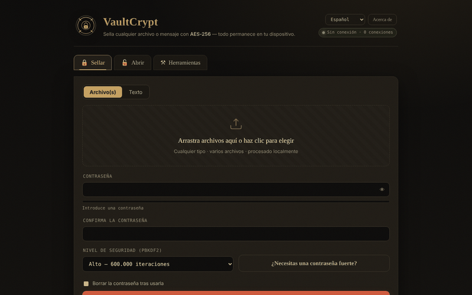

# VaultCrypt

[English](README.md) · [Română](README.ro.md) · [Français](README.fr.md) · [Italiano](README.it.md) · **Español** · [Português](README.pt.md) · [Deutsch](README.de.md) · [Magyar](README.hu.md)

**Versión:** 2.2.3 · **Última actualización:** 2026-10-22

Idiomas de la interfaz: **Română, English, Français, Italiano, Español, Português (PT), Deutsch, Magyar**

**En línea / demo:** https://chiuta.github.io/VaultCrypt/

Cifrado/descifrado de archivos y texto en el navegador, en un único `index.html` (8 idiomas), más un generador de contraseñas y sumas de verificación.

## Cómo funciona (según el código)
- Clave derivada de la contraseña con PBKDF2-HMAC-SHA-256 (310.000 / 600.000 / 1.000.000 de iteraciones; por defecto «High» = 600.000; el último nivel usado al sellar se recuerda localmente en `localStorage`, clave `vaultcrypt.sec`), sal aleatoria de 16 bytes.
- Cifrado AES-256-GCM (Web Crypto) con IV aleatorio de 12 bytes; la cabecera del contenedor (39 bytes) se autentica como datos adicionales.
- Formato `.vault` (magic `VCRYPT`, versión 1/2) o bloque de texto «armored» para mensajes.
- Las contraseñas generadas usan `crypto.getRandomValues`. Sumas de verificación: SHA-256/384/512 y SHA-1 (SHA-1 es débil; solo para comprobar la integridad de archivos, no para seguridad).

## Advertencias
- **Sin auditoría independiente.** Código escrito por un único autor, sin auditoría de seguridad externa; no lo uses como única protección de datos críticos.
- **Contraseña perdida = datos perdidos.** No hay recuperación. Conserva copias de seguridad y guarda la contraseña en un lugar seguro.
- La contraseña permanece en la memoria del navegador durante la sesión; un dispositivo comprometido (malware, extensiones) anula la protección.

## Datos y privacidad
Ninguna solicitud de red: la página tiene una CSP con `connect-src 'self'`, y `fetch`/`XMLHttpRequest`/`sendBeacon` están bloqueados en el código (registro «Privacy audit» en la página). Sin telemetría, sin fuentes ni scripts externos. Comprobado en la auditoría: 0 solicitudes externas al cargar. Los únicos enlaces externos son los del pie de página y de la ventana «Acerca de» (solo se abren al hacer clic).

## Limitaciones
Los archivos se leen íntegramente en memoria (varias veces durante el cifrado): límite práctico de 400 MB por operación (probado: 380 MB bien, ≈860 MB bloquea la pestaña). Para archivos mayores, usa una herramienta de escritorio.

La CSP ya no permite `'unsafe-inline'` para scripts: el único script de la página está autorizado mediante un hash SHA-256 en la metaetiqueta CSP (tras cualquier cambio en el script hay que recalcular el hash), y los manejadores inline se han sustituido por delegación de eventos. Los estilos inline siguen permitidos. Los archivos grandes se procesan íntegramente en memoria.

## Licencia
MIT, según la cabecera de `index.html`; consulta `LICENSE`.

Auditoría: 2026-10-10

## Historial / Changelog

### 2.2.3 — 2026-10-22
- Seguridad: las contraseñas de menos de 12 caracteres ya no se aceptan en silencio: la aplicación muestra una advertencia (traducida a los 8 idiomas) y exige la confirmación explícita «Sellar de todos modos». El mínimo absoluto sigue siendo de 4 caracteres.

### 2.2.2 — 2026-10-22
- la etiqueta de accesibilidad del selector de idioma y el término «additional authenticated data» (AAD) de la sección Acerca de ahora están traducidos a todos los idiomas.

### 2.2.1 — 2026-10-22
- El título, las metaetiquetas, el aviso de seguridad del pie de página y los aria-label siguen ahora el idioma de la interfaz; la descripción del panel fff-kit está localizada.

### 2.1.0 — 2026-10-14
- Copia de seguridad y etiquetado de datos (fff-kit).

### 12 de octubre de 2026 (v2.0.4)
- 2.0.4 — 2026-10-12: la versión y la fecha de la última actualización se muestran en la aplicación

### 11 de octubre de 2026 (v2.0.3)
- Archivos grandes: probado de verdad (Chromium, sin conexión) — 120 MB y 380 MB se sellan y se desellan de forma idéntica (≈5 s cada uno con 310.000 iteraciones), pero con ≈860 MB la pestaña se bloquea al descargar. Por eso, a partir de 150 MB aparece una nota de «datos grandes» durante la operación, y por encima de 400 MB la aplicación rechaza con un mensaje claro (en lugar de bloquear la pestaña); los errores de memoria tienen su propio mensaje, en los 6 idiomas. El límite se aplica también al desellar.
- Versión v2.0.3 en el pie de página.

### 11 de octubre de 2026 (v2.0.2)
- Indicador en vivo «las contraseñas coinciden / aún no coinciden» bajo el campo de confirmación (`role=status`) y aviso de Bloq Mayús en los campos de contraseña, en los 6 idiomas; Ctrl/Cmd+Intro para ejecutar la acción ya existía. Probado sin conexión con CSP activa: 0 errores, axe 0.

### 11 de octubre de 2026 (v2.0.1)
- Un bloque armored modificado/truncado (base64 no válido, pero con los marcadores presentes) muestra ahora un mensaje de integridad aparte («dañado o incompleto»), en los 6 idiomas, en lugar de «no se encontró un bloque armored válido»; una modificación que mantiene el base64 válido sigue dando «contraseña incorrecta o contenedor alterado».
- CSP: eliminado `'unsafe-inline'` de `script-src` (hash SHA-256 para el único script); los 26 manejadores inline se han sustituido por delegación de eventos; probado con CSP activa.
- El contenido está envuelto en `<main>` (axe: 0 infracciones); el nivel por defecto «High» queda documentado explícitamente (recordar el último nivel explica un posible «Balanced» al reabrir).
- Versión v2.0.2 en el pie de página.
