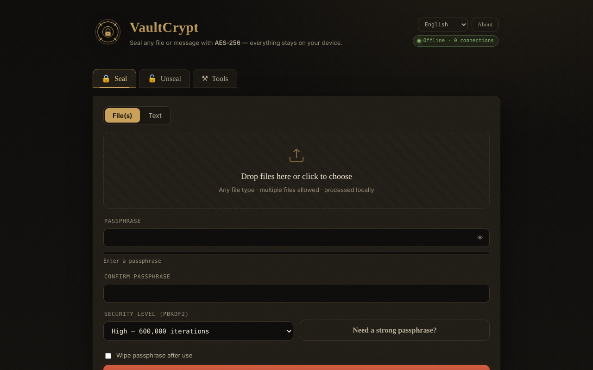

# VaultCrypt

[English](README.md) · [Română](README.ro.md) · **Français** · [Italiano](README.it.md) · [Español](README.es.md) · [Português](README.pt.md) · [Deutsch](README.de.md) · [Magyar](README.hu.md)

**Version :** 2.1.0 · **Dernière mise à jour :** 2026-10-14

**En ligne / démo :** https://chiuta.github.io/VaultCrypt/

Chiffrement/déchiffrement de fichiers et de texte dans le navigateur, dans un seul `index.html` (6 langues), avec en plus un générateur de mots de passe et des sommes de contrôle.

## Fonctionnement (d'après le code)
- Clé dérivée du mot de passe avec PBKDF2-HMAC-SHA-256 (310 000 / 600 000 / 1 000 000 d'itérations ; par défaut « High » = 600 000 ; le dernier niveau utilisé lors du scellement est mémorisé localement dans `localStorage`, clé `vaultcrypt.sec`), sel aléatoire de 16 octets.
- Chiffrement AES-256-GCM (Web Crypto) avec un IV aléatoire de 12 octets ; l'en-tête du conteneur (39 octets) est authentifié en tant que données additionnelles.
- Format `.vault` (magic `VCRYPT`, version 1/2) ou bloc texte « blindé » (armored) pour les messages.
- Les mots de passe générés utilisent `crypto.getRandomValues`. Sommes de contrôle : SHA-256/384/512 et SHA-1 (SHA-1 est faible ; à utiliser uniquement pour vérifier l'intégrité des fichiers, pas pour la sécurité).

## Avertissements
- **Non audité de façon indépendante.** Code écrit par un seul auteur, sans audit de sécurité externe ; ne l'utilisez pas comme unique protection de données critiques.
- **Mot de passe perdu = données perdues.** Il n'existe aucune récupération. Conservez des sauvegardes et le mot de passe dans un endroit sûr.
- Le mot de passe reste dans la mémoire du navigateur pendant la durée de la session ; un appareil compromis (logiciel malveillant, extensions) annule la protection.

## Données et confidentialité
Aucune requête réseau : la page a une CSP avec `connect-src 'self'`, et `fetch`/`XMLHttpRequest`/`sendBeacon` sont bloqués dans le code (journal « Privacy audit » dans la page). Pas de télémétrie, pas de polices ni de scripts externes. Vérifié lors de l'audit : 0 requête externe au chargement. Les seuls liens externes sont ceux du pied de page et de la fenêtre « À propos » (ils ne s'ouvrent qu'au clic).

## Limites
Les fichiers sont lus intégralement en mémoire (plusieurs fois pendant le chiffrement) : limite pratique de 400 Mo par opération (testé : 380 Mo OK, ≈860 Mo bloque l'onglet). Pour des fichiers plus gros, utilisez un outil de bureau.

La CSP n'autorise plus `'unsafe-inline'` pour les scripts : l'unique script de la page est autorisé par un hachage SHA-256 dans la balise meta CSP (après toute modification du script, le hachage doit être recalculé), et les gestionnaires inline ont été remplacés par une délégation d'événements. Les styles inline restent autorisés. Les fichiers volumineux sont traités intégralement en mémoire.

## Licence
MIT, conformément à l'en-tête de `index.html` ; voir `LICENSE`.

Audit : 2026-10-10

## Historique / Changelog

### 2.1.0 — 2026-10-14
- Sauvegarde et étiquetage des données (fff-kit).

### 12 octobre 2026 (v2.0.4)
- 2.0.4 — 2026-10-12 : la version et la date de la dernière mise à jour sont affichées dans l'application

### 11 octobre 2026 (v2.0.3)
- Fichiers volumineux : testé pour de bon (Chromium, hors ligne) — 120 Mo et 380 Mo sont scellés et descellés à l'identique (≈5 s chacun à 310 000 itérations), mais à ≈860 Mo l'onglet se bloque au téléchargement. C'est pourquoi, à partir de 150 Mo, une note « données volumineuses » apparaît pendant l'opération, et au-delà de 400 Mo l'application refuse avec un message clair (au lieu de bloquer l'onglet) ; les erreurs de mémoire ont leur propre message, dans les 6 langues. La limite s'applique aussi au descellement.
- Version v2.0.3 dans le pied de page.

### 11 octobre 2026 (v2.0.2)
- Indicateur en direct « les mots de passe correspondent / ne correspondent pas encore » sous le champ de confirmation (`role=status`) et avertissement Caps Lock sur les champs de mot de passe, dans les 6 langues ; Ctrl/Cmd+Entrée pour lancer l'action existait déjà. Testé hors ligne avec CSP active : 0 erreur, axe 0.

### 11 octobre 2026 (v2.0.1)
- Un bloc armored modifié/tronqué (base64 invalide, mais avec les marqueurs présents) affiche désormais un message d'intégrité distinct (« endommagé ou incomplet »), dans les 6 langues, au lieu de « bloc armored valide introuvable » ; une modification qui conserve un base64 valide continue de donner « mot de passe incorrect ou conteneur altéré ».
- CSP : suppression de `'unsafe-inline'` dans `script-src` (hachage SHA-256 pour l'unique script) ; les 26 gestionnaires inline ont été remplacés par une délégation d'événements ; testé avec CSP active.
- Le contenu est encadré par `<main>` (axe : 0 violation) ; le niveau par défaut « High » est documenté explicitement (la mémorisation du dernier niveau explique un éventuel « Balanced » à la réouverture).
- Version v2.0.2 dans le pied de page.
