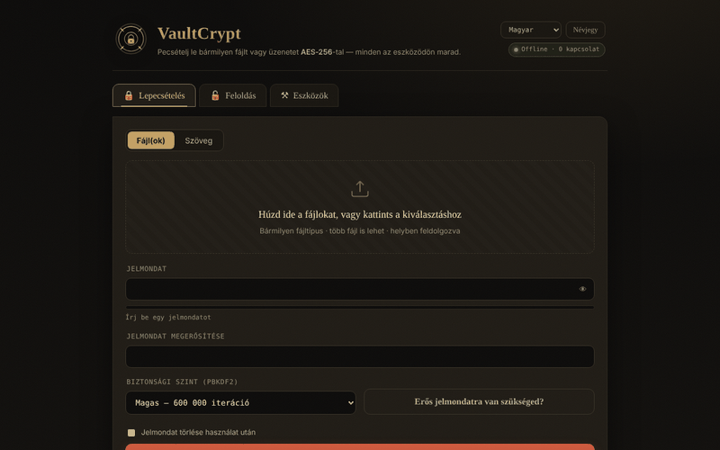

# VaultCrypt

[English](README.md) · [Română](README.ro.md) · [Français](README.fr.md) · [Italiano](README.it.md) · [Español](README.es.md) · [Português](README.pt.md) · [Deutsch](README.de.md) · **Magyar**

**Verzió:** 3.1.2 · **Utolsó frissítés:** 2026-10-31

**Állapot:** kísérleti · **Offline:** teljes

A felület nyelvei: **Română, English, Français, Italiano, Español, Português (PT), Deutsch, Magyar**

**Élő verzió / demó:** https://chiuta.github.io/VaultCrypt/

Fájlok és szövegek titkosítása/visszafejtése a böngészőben, egyetlen `index.html` fájlban (8 nyelv), valamint jelszógenerátor és ellenőrző összegek.

## Hogyan működik (a kód alapján)
- A kulcsot a jelszóból PBKDF2-HMAC-SHA-256 származtatja (600 000 / 1 000 000 iteráció; alapértelmezés: „High” = 600 000; a lezáráskor utoljára használt szintet a program helyben, a `localStorage`-ban jegyzi meg, kulcs: `vaultcrypt.sec`), véletlenszerű 16 bájtos sóval.
- AES-256-GCM titkosítás (Web Crypto) véletlenszerű 12 bájtos IV-vel; a konténer fejlécét (39 bájt) kiegészítő adatként hitelesíti.
- `.vault` formátum (magic `VCRYPT`, 1/2. verzió) vagy szöveges „armored” blokk üzenetekhez.
- A generált jelszavak a `crypto.getRandomValues` függvényt használják. Ellenőrző összegek: SHA-256/384/512 és SHA-1 (az SHA-1 gyenge; csak fájlok sértetlenségének ellenőrzésére használd, biztonsági célra nem).

## Figyelmeztetések
- **Nem volt független auditon.** Egyetlen szerző kódja, külső biztonsági audit nélkül; ne használd kritikus adatok egyedüli védelmeként.
- **Elveszett jelszó = elveszett adatok.** Nincs helyreállítás. Őrizz biztonsági másolatokat, és a jelszót tartsd biztos helyen.
- A jelszó a munkamenet idejére a böngésző memóriájában marad; egy feltört eszköz (kártevő, bővítmények) hatálytalanítja a védelmet.

## Adatok és adatvédelem
Nincs hálózati kérés: az oldal CSP-je `connect-src 'self'`, a `fetch`/`XMLHttpRequest`/`sendBeacon` pedig le van tiltva a kódban („Privacy audit” napló az oldalon). Nincs telemetria, nincsenek külső betűtípusok vagy szkriptek. Az auditon ellenőrizve: 0 külső kérés betöltéskor. Az egyetlen külső hivatkozások a láblécben és a „Névjegy” ablakban vannak (csak kattintásra nyílnak meg).

## Korlátok
A fájlokat a program teljes egészében beolvassa a memóriába (titkosítás közben többször is): a gyakorlati határ műveletenként 400 MB (tesztelve: 380 MB rendben, ≈860 MB lefagyasztja a lapot). Nagyobb fájlokhoz használj asztali eszközt.

A CSP már nem engedélyezi az `'unsafe-inline'` értéket a szkriptekhez: az oldal egyetlen szkriptjét SHA-256 hash engedélyezi a CSP meta címkében (a szkript bármilyen módosítása után a hasht újra kell számolni), az inline eseménykezelőket pedig eseménydelegálás váltotta fel. Az inline stílusok továbbra is engedélyezettek. A nagy fájlokat a program teljes egészében a memóriában dolgozza fel.

## Licenc
MIT, az `index.html` fejléce szerint; lásd: `LICENSE`.

Audit: 2026-10-10

## Előzmények / Changelog

### 2.2.5 — 2026-10-22
- fff-kit 1.1.4: érintési célpontok és minimális szövegméret; érintési célpontok/szöveg javítva

### 2.2.4 — 2026-10-22
- fff-kit 1.1.2: PBKDF2 600 000 iterációval, clickjacking elleni védelem.

### 2.2.3 — 2026-10-22
- Biztonság: a 12 karakternél rövidebb jelmondatokat a program már nem fogadja el szó nélkül: figyelmeztetést jelenít meg (mind a 8 nyelvre lefordítva), és kifejezett „Mégis lepecsételem” megerősítést kér. Az abszolút minimum továbbra is 4 karakter.

### 2.2.2 — 2026-10-22
- a nyelvválasztó hozzáférhetőségi címkéje és az „additional authenticated data” (AAD) kifejezés a Névjegy részben mostantól minden nyelven le van fordítva.

### 2.2.1 — 2026-10-22
- A cím, a meta címkék, a lábléc biztonsági figyelmeztetése és az aria-label-ek mostantól a felület nyelvét követik; az fff-kit panel leírása lokalizált.

### 2.1.0 — 2026-10-14
- Adatmentés és adatcímkézés (fff-kit).

### 2026. október 12. (v2.0.4)
- 2.0.4 — 2026-10-12: a verzió és az utolsó frissítés dátuma megjelenik az alkalmazásban

### 2026. október 11. (v2.0.3)
- Nagy fájlok: valóban kipróbálva (Chromium, offline) — a 120 MB-os és a 380 MB-os fájl egyaránt azonosan lezárható és feloldható (kb. 5 s mindkettő 310 000 iterációnál), de ≈860 MB-nál a lap letöltéskor lefagy. Ezért 150 MB-tól a művelet közben „nagy adatmennyiség” megjegyzés jelenik meg, 400 MB felett pedig az alkalmazás egyértelmű üzenettel elutasítja a műveletet (a lap lefagyasztása helyett); a memóriahibák saját üzenetet kapnak, mind a 6 nyelven. A korlát a feloldásra is érvényes.
- A v2.0.3 verzió a láblécben.

### 2026. október 11. (v2.0.2)
- Élő „a jelszavak egyeznek / még nem egyeznek” jelzés a megerősítő mező alatt (`role=status`) és Caps Lock figyelmeztetés a jelszómezőknél, mind a 6 nyelven; a Ctrl/Cmd+Enter a művelethez már korábban is megvolt. Offline tesztelve aktív CSP mellett: 0 hiba, axe 0.

### 2026. október 11. (v2.0.1)
- Egy módosított/csonkolt armored blokk (érvénytelen base64, de a jelölők megvannak) most külön sértetlenségi üzenetet jelenít meg („sérült vagy hiányos”), mind a 6 nyelven, az „érvényes armored blokk nem található” helyett; az érvényes base64-et megőrző módosítás továbbra is „hibás jelszó vagy megváltoztatott konténer” üzenetet ad.
- CSP: az `'unsafe-inline'` eltávolítva a `script-src`-ből (SHA-256 hash az egyetlen szkripthez); a 26 inline eseménykezelőt eseménydelegálás váltotta fel; aktív CSP mellett tesztelve.
- A tartalom `<main>` elembe van foglalva (axe: 0 szabálysértés); az alapértelmezett „High” szint kifejezetten dokumentálva van (az utolsó szint megjegyzése magyarázza a megnyitáskor esetleg látható „Balanced” értéket).
- A v2.0.2 verzió a láblécben.
