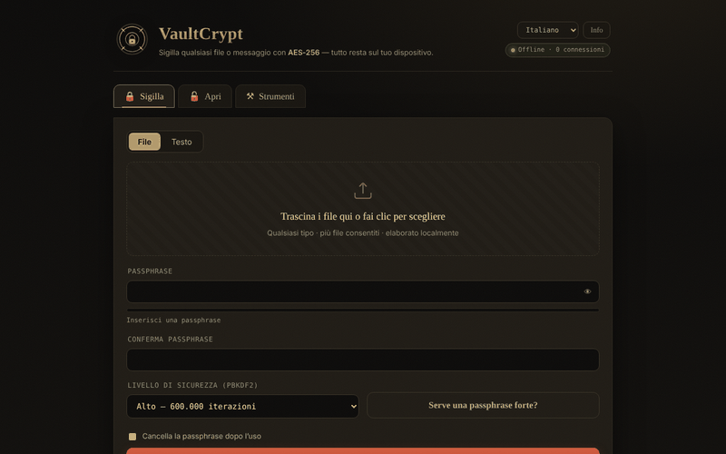

# VaultCrypt

[English](README.md) · [Română](README.ro.md) · [Français](README.fr.md) · **Italiano** · [Español](README.es.md) · [Português](README.pt.md) · [Deutsch](README.de.md) · [Magyar](README.hu.md)

**Versione:** 2.2.5 · **Ultimo aggiornamento:** 2026-10-22

Lingue dell'interfaccia: **Română, English, Français, Italiano, Español, Português (PT), Deutsch, Magyar**

**Online / demo:** https://chiuta.github.io/VaultCrypt/

Cifratura/decifratura di file e testo nel browser, in un unico `index.html` (8 lingue), più un generatore di password e checksum.

## Come funziona (dal codice)
- Chiave derivata dalla password con PBKDF2-HMAC-SHA-256 (600.000 / 1.000.000 di iterazioni; predefinito «High» = 600.000; l'ultimo livello usato in fase di sigillatura viene memorizzato localmente in `localStorage`, chiave `vaultcrypt.sec`), salt casuale di 16 byte.
- Cifratura AES-256-GCM (Web Crypto) con IV casuale di 12 byte; l'intestazione del contenitore (39 byte) è autenticata come dati aggiuntivi.
- Formato `.vault` (magic `VCRYPT`, versione 1/2) oppure blocco testuale «armored» per i messaggi.
- Le password generate usano `crypto.getRandomValues`. Checksum: SHA-256/384/512 e SHA-1 (SHA-1 è debole; solo per verificare l'integrità dei file, non per la sicurezza).

## Avvertenze
- **Non sottoposto ad audit indipendente.** Codice scritto da un singolo autore, senza audit di sicurezza esterno; non usarlo come unica protezione per dati critici.
- **Password persa = dati persi.** Non esiste alcun recupero. Conserva copie di backup e la password in un luogo sicuro.
- La password resta nella memoria del browser per la durata della sessione; un dispositivo compromesso (malware, estensioni) annulla la protezione.

## Dati e privacy
Nessuna richiesta di rete: la pagina ha una CSP con `connect-src 'self'`, e `fetch`/`XMLHttpRequest`/`sendBeacon` sono bloccati nel codice (registro «Privacy audit» nella pagina). Nessuna telemetria, nessun font o script esterno. Verificato in fase di audit: 0 richieste esterne al caricamento. Gli unici collegamenti esterni sono quelli nel piè di pagina e nella finestra «Informazioni» (si aprono solo al clic).

## Limitazioni
I file vengono letti interamente in memoria (più volte durante la cifratura): limite pratico di 400 MB per operazione (testato: 380 MB ok, ≈860 MB blocca la scheda). Per file più grandi usa uno strumento desktop.

La CSP non consente più `'unsafe-inline'` per gli script: l'unico script della pagina è autorizzato tramite hash SHA-256 nel meta CSP (dopo qualsiasi modifica allo script l'hash va ricalcolato), e i gestori inline sono stati sostituiti con la delega degli eventi. Gli stili inline restano consentiti. I file di grandi dimensioni vengono elaborati interamente in memoria.

## Licenza
MIT, secondo l'intestazione di `index.html`; vedi `LICENSE`.

Audit: 2026-10-10

## Cronologia / Changelog

### 2.2.5 — 2026-10-22
- fff-kit 1.1.4: bersagli touch e testo minimo; bersagli touch/testo corretti

### 2.2.4 — 2026-10-22
- fff-kit 1.1.2: PBKDF2 a 600.000 iterazioni, protezione anti-clickjacking.

### 2.2.3 — 2026-10-22
- Sicurezza: le passphrase di meno di 12 caratteri non sono più accettate in silenzio: l'app mostra un avviso (tradotto nelle 8 lingue) e richiede la conferma esplicita «Sigilla comunque». Il minimo assoluto resta di 4 caratteri.

### 2.2.2 — 2026-10-22
- l'etichetta di accessibilità del selettore di lingua e il termine «additional authenticated data» (AAD) della sezione Informazioni sono ora tradotti in tutte le lingue.

### 2.2.1 — 2026-10-22
- Titolo, meta tag, avviso di sicurezza nel piè di pagina e aria-label seguono ora la lingua dell'interfaccia; la descrizione del pannello fff-kit è localizzata.

### 2.1.0 — 2026-10-14
- Backup e etichettatura dei dati (fff-kit).

### 12 ottobre 2026 (v2.0.4)
- 2.0.4 — 2026-10-12: la versione e la data dell'ultimo aggiornamento sono mostrate nell'app

### 11 ottobre 2026 (v2.0.3)
- File di grandi dimensioni: testato davvero (Chromium, offline) — 120 MB e 380 MB vengono sigillati e dissigillati in modo identico (≈5 s ciascuno a 310.000 iterazioni), ma a ≈860 MB la scheda si blocca al download. Per questo, da 150 MB compare una nota «dati voluminosi» durante l'operazione, e oltre 400 MB l'app rifiuta con un messaggio chiaro (invece di bloccare la scheda); gli errori di memoria hanno un messaggio proprio, in tutte e 6 le lingue. Il limite vale anche per la dissigillatura.
- Versione v2.0.3 nel piè di pagina.

### 11 ottobre 2026 (v2.0.2)
- Indicatore in tempo reale «le password coincidono / non coincidono ancora» sotto il campo di conferma (`role=status`) e avviso Caps Lock nei campi password, in tutte e 6 le lingue; Ctrl/Cmd+Invio per l'azione esisteva già. Testato offline con CSP attiva: 0 errori, axe 0.

### 11 ottobre 2026 (v2.0.1)
- Un blocco armored modificato/troncato (base64 non valido, ma con i marcatori presenti) mostra ora un messaggio di integrità separato («danneggiato o incompleto»), in tutte e 6 le lingue, invece di «blocco armored valido non trovato»; una modifica che mantiene il base64 valido continua a dare «password errata o contenitore alterato».
- CSP: rimosso `'unsafe-inline'` da `script-src` (hash SHA-256 per l'unico script); i 26 gestori inline sono stati sostituiti con la delega degli eventi; testato con CSP attiva.
- Il contenuto è racchiuso in `<main>` (axe: 0 violazioni); il livello predefinito «High» è documentato esplicitamente (la memorizzazione dell'ultimo livello spiega un eventuale «Balanced» alla riapertura).
- Versione v2.0.2 nel piè di pagina.
