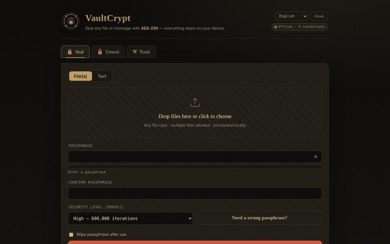

# VaultCrypt

**English** · [Română](README.ro.md) · [Français](README.fr.md) · [Italiano](README.it.md) · [Español](README.es.md) · [Português](README.pt.md) · [Deutsch](README.de.md) · [Magyar](README.hu.md)

**Version:** 2.2.8 · **Last updated:** 2026-10-26

Interface languages: **Română, English, Français, Italiano, Español, Português (PT), Deutsch, Magyar**

**Live / demo:** https://chiuta.github.io/VaultCrypt/

In-browser encryption/decryption of files and text, in a single `index.html` (8 languages), plus a password generator and checksums.

## How it works (from the code)
- Key derived from the password with PBKDF2-HMAC-SHA-256 (600,000 / 1,000,000 iterations; default "High" = 600,000; the last level used when sealing is remembered locally in `localStorage`, key `vaultcrypt.sec`), random 16-byte salt.
- AES-256-GCM encryption (Web Crypto) with a random 12-byte IV; the container header (39 bytes) is authenticated as additional data.
- `.vault` format (magic `VCRYPT`, version 1/2) or a text "armored" block for messages.
- Generated passwords use `crypto.getRandomValues`. Checksums: SHA-256/384/512 and SHA-1 (SHA-1 is weak; use it only to verify file integrity, not for security).

## Warnings
- **Not independently audited.** Code written by a single author, with no external security audit; do not use it as the sole protection for critical data.
- **Lost password = lost data.** There is no recovery. Keep backups and store the password in a safe place.
- The password stays in the browser's memory for the duration of the session; a compromised device (malware, extensions) defeats the protection.

## Data and privacy
No network requests: the page has a CSP with `connect-src 'self'`, and `fetch`/`XMLHttpRequest`/`sendBeacon` are blocked in the code ("Privacy audit" log in the page). No telemetry, no external fonts or scripts. Checked in the audit: 0 external requests on load. The only external links are those in the footer and in the "About" window (they open only on click).

## Limitations
Files are read entirely into memory (several times over during encryption): practical limit 400 MB per operation (tested: 380 MB OK, ≈860 MB freezes the tab). For larger files, use a desktop tool.

The CSP no longer allows `'unsafe-inline'` for scripts: the page's single script is authorized by a SHA-256 hash in the CSP meta tag (the hash must be recomputed after any change to the script), and inline handlers have been replaced with event delegation. Inline styles remain allowed. Large files are processed entirely in memory.

## License
MIT, per the header of `index.html`; see `LICENSE`.

Audit: 2026-10-10

## History / Changelog

### 2.2.5 — 2026-10-22
- fff-kit 1.1.4: touch targets and minimum text size; touch targets/text fixed

### 2.2.4 — 2026-10-22
- fff-kit 1.1.2: PBKDF2 600,000 iterations, anti-clickjacking protection.

### 2.2.3 — 2026-10-22
- Security: passphrases shorter than 12 characters are no longer accepted silently: the app shows a warning (translated into all 8 languages) and requires an explicit "Seal anyway" confirmation. The absolute minimum stays at 4 characters.

### 2.2.2 — 2026-10-22
- the language selector's accessibility label and the "additional authenticated data" (AAD) term in the About section are now translated into all languages.

### 2.2.1 — 2026-10-22
- Title, meta tags, security warning in the footer and aria-labels now follow the interface language; the fff-kit panel description is localized.

### 2.1.0 — 2026-10-14
- Data backup and labelling (fff-kit).

### 12 October 2026 (v2.0.4)
- 2.0.4 — 2026-10-12: the version and the date of the last update are shown in the app

### 11 October 2026 (v2.0.3)
- Large files: really tested (Chromium, offline) — 120 MB and 380 MB are sealed and unsealed identically (≈5 s each at 310,000 iterations), but at ≈860 MB the tab freezes on download. That is why, from 150 MB, a "large data" note appears during the operation, and above 400 MB the app refuses with a clear message (instead of freezing the tab); memory errors get their own message, in all 6 languages. The limit also applies to unsealing.
- Version v2.0.3 in the footer.

### 11 October 2026 (v2.0.2)
- Live "passwords match / do not match yet" indicator below the confirmation field (`role=status`) and a Caps Lock warning on the password fields, in all 6 languages; Ctrl/Cmd+Enter for the action already existed. Tested offline with CSP active: 0 errors, axe 0.

### 11 October 2026 (v2.0.1)
- A modified/truncated armored block (invalid base64, but with the markers present) now shows a separate integrity message ("damaged or incomplete"), in all 6 languages, instead of "valid armored block not found"; a modification that keeps the base64 valid still gives "wrong password or tampered container".
- CSP: removed `'unsafe-inline'` from `script-src` (SHA-256 hash for the single script); the 26 inline handlers were replaced with event delegation; tested with CSP active.
- Content is wrapped in `<main>` (axe: 0 violations); the default "High" level is documented explicitly (remembering the last level explains a possible "Balanced" on reopening).
- Version v2.0.2 in the footer.
