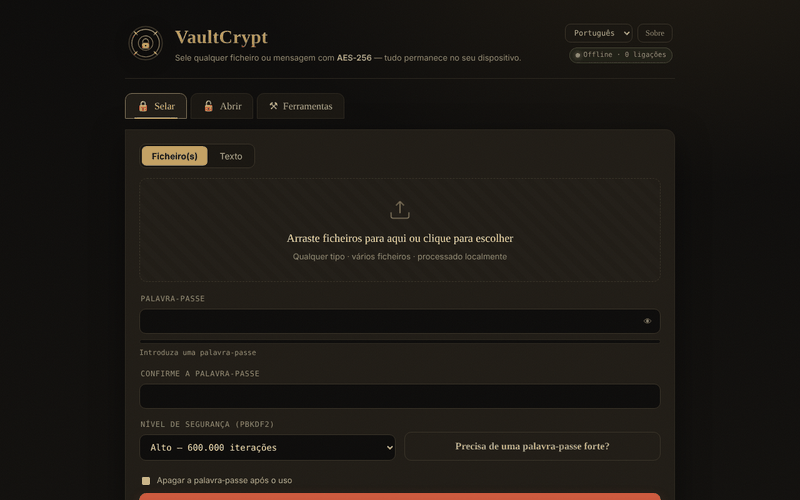

# VaultCrypt

[English](README.md) · [Română](README.ro.md) · [Français](README.fr.md) · [Italiano](README.it.md) · [Español](README.es.md) · **Português** · [Deutsch](README.de.md) · [Magyar](README.hu.md)

**Versão:** 2.2.2 · **Última atualização:** 2026-10-22

Idiomas da interface: **Română, English, Français, Italiano, Español, Português (PT), Deutsch, Magyar**

**Online / demonstração:** https://chiuta.github.io/VaultCrypt/

Cifragem/decifragem de ficheiros e texto no navegador, num único `index.html` (8 línguas), mais um gerador de palavras-passe e somas de verificação.

## Como funciona (segundo o código)
- Chave derivada da palavra-passe com PBKDF2-HMAC-SHA-256 (310 000 / 600 000 / 1 000 000 de iterações; por omissão «High» = 600 000; o último nível usado ao selar é guardado localmente em `localStorage`, chave `vaultcrypt.sec`), sal aleatório de 16 bytes.
- Cifragem AES-256-GCM (Web Crypto) com IV aleatório de 12 bytes; o cabeçalho do contentor (39 bytes) é autenticado como dados adicionais.
- Formato `.vault` (magic `VCRYPT`, versão 1/2) ou bloco de texto «armored» para mensagens.
- As palavras-passe geradas usam `crypto.getRandomValues`. Somas de verificação: SHA-256/384/512 e SHA-1 (o SHA-1 é fraco; apenas para verificar a integridade de ficheiros, não para segurança).

## Avisos
- **Sem auditoria independente.** Código escrito por um único autor, sem auditoria de segurança externa; não o uses como única proteção de dados críticos.
- **Palavra-passe perdida = dados perdidos.** Não existe recuperação. Guarda cópias de segurança e a palavra-passe num local seguro.
- A palavra-passe permanece na memória do navegador durante a sessão; um dispositivo comprometido (malware, extensões) anula a proteção.

## Dados e privacidade
Nenhum pedido de rede: a página tem uma CSP com `connect-src 'self'`, e `fetch`/`XMLHttpRequest`/`sendBeacon` estão bloqueados no código (registo «Privacy audit» na página). Sem telemetria, sem tipos de letra nem scripts externos. Verificado na auditoria: 0 pedidos externos ao carregar. As únicas ligações externas são as do rodapé e da janela «Acerca de» (só se abrem ao clicar).

## Limitações
Os ficheiros são lidos integralmente para a memória (várias vezes durante a cifragem): limite prático de 400 MB por operação (testado: 380 MB OK, ≈860 MB bloqueia o separador). Para ficheiros maiores, usa uma ferramenta de ambiente de trabalho.

A CSP já não permite `'unsafe-inline'` para scripts: o único script da página é autorizado por um hash SHA-256 na meta etiqueta CSP (após qualquer alteração ao script o hash tem de ser recalculado), e os manipuladores inline foram substituídos por delegação de eventos. Os estilos inline continuam permitidos. Os ficheiros grandes são processados integralmente em memória.

## Licença
MIT, conforme o cabeçalho de `index.html`; ver `LICENSE`.

Auditoria: 2026-10-10

## Histórico / Changelog

### 2.2.2 — 2026-10-22
- a etiqueta de acessibilidade do seletor de idioma e o termo «additional authenticated data» (AAD) da secção Acerca estão agora traduzidos em todos os idiomas.

### 2.2.1 — 2026-10-22
- O título, as metaetiquetas, o aviso de segurança do rodapé e os aria-label seguem agora o idioma da interface; a descrição do painel fff-kit está localizada.

### 2.1.0 — 2026-10-14
- Cópia de segurança e etiquetagem de dados (fff-kit).

### 12 de outubro de 2026 (v2.0.4)
- 2.0.4 — 2026-10-12: a versão e a data da última atualização são apresentadas na aplicação

### 11 de outubro de 2026 (v2.0.3)
- Ficheiros grandes: testado a sério (Chromium, offline) — 120 MB e 380 MB são selados e desselados de forma idêntica (≈5 s cada, com 310 000 iterações), mas com ≈860 MB o separador bloqueia na transferência. Por isso, a partir de 150 MB surge uma nota de «dados volumosos» durante a operação, e acima de 400 MB a aplicação recusa com uma mensagem clara (em vez de bloquear o separador); os erros de memória têm mensagem própria, nas 6 línguas. O limite aplica-se também ao dessselar.
- Versão v2.0.3 no rodapé.

### 11 de outubro de 2026 (v2.0.2)
- Indicador em tempo real «as palavras-passe coincidem / ainda não coincidem» por baixo do campo de confirmação (`role=status`) e aviso de Caps Lock nos campos de palavra-passe, nas 6 línguas; Ctrl/Cmd+Enter para a ação já existia. Testado offline com CSP ativa: 0 erros, axe 0.

### 11 de outubro de 2026 (v2.0.1)
- Um bloco armored modificado/truncado (base64 inválido, mas com os marcadores presentes) mostra agora uma mensagem de integridade separada («danificado ou incompleto»), nas 6 línguas, em vez de «bloco armored válido não encontrado»; uma modificação que mantém o base64 válido continua a dar «palavra-passe errada ou contentor alterado».
- CSP: removido `'unsafe-inline'` de `script-src` (hash SHA-256 para o único script); os 26 manipuladores inline foram substituídos por delegação de eventos; testado com CSP ativa.
- O conteúdo está envolvido em `<main>` (axe: 0 violações); o nível por omissão «High» fica documentado explicitamente (memorizar o último nível explica um eventual «Balanced» ao reabrir).
- Versão v2.0.2 no rodapé.
