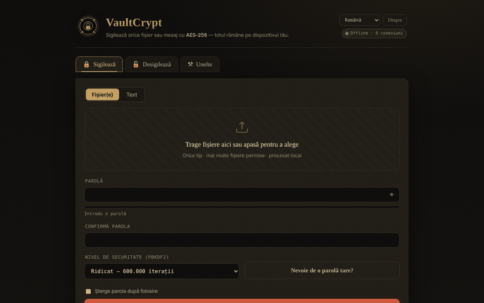

# VaultCrypt

[English](README.md) · **Română** · [Français](README.fr.md) · [Italiano](README.it.md) · [Español](README.es.md) · [Português](README.pt.md) · [Deutsch](README.de.md) · [Magyar](README.hu.md)

**Versiune:** 2.2.2 · **Ultima actualizare:** 2026-10-22

Limbile interfeței: **Română, English, Français, Italiano, Español, Português (PT), Deutsch, Magyar**

**Live / demo:** https://chiuta.github.io/VaultCrypt/

Criptare/decriptare de fișiere și text în browser, într-un singur `index.html` (8 limbi), plus generator de parole și sume de control.

## Cum funcționează (din cod)
- Cheie derivată din parolă cu PBKDF2-HMAC-SHA-256 (310.000 / 600.000 / 1.000.000 iterații; implicit „High” = 600.000; ultimul nivel folosit la sigilare este reținut local în `localStorage`, cheia `vaultcrypt.sec`), sare aleatoare de 16 octeți.
- Criptare AES-256-GCM (Web Crypto) cu IV aleator de 12 octeți; antetul containerului (39 octeți) este autentificat ca date adiționale.
- Format `.vault` (magic `VCRYPT`, versiune 1/2) sau bloc „armurat” text pentru mesaje.
- Parolele generate folosesc `crypto.getRandomValues`. Sume de control: SHA-256/384/512 și SHA-1 (SHA-1 este slab; doar pentru verificarea integrității fișierelor, nu pentru securitate).

## Avertismente
- **Neauditat independent.** Cod scris de un singur autor, fără audit de securitate extern; nu-l folosi ca unică protecție pentru date critice.
- **Parolă pierdută = date pierdute.** Nu există recuperare. Păstrează copii de siguranță și parola într-un loc sigur.
- Parola rămâne în memoria browserului pe durata sesiunii; un dispozitiv compromis (malware, extensii) anulează protecția.

## Date și confidențialitate
Nicio cerere de rețea: pagina are CSP cu `connect-src 'self'`, iar `fetch`/`XMLHttpRequest`/`sendBeacon` sunt blocate în cod (jurnal „Privacy audit” în pagină). Fără telemetrie, fără fonturi sau scripturi externe. Verificat la audit: 0 cereri externe la încărcare. Singurele legături externe sunt cele din subsol și fereastra „Despre” (se deschid doar la click).

## Limitări
Fișierele sunt citite integral în memorie (de câteva ori, în timpul criptării): limită practică 400 MB per operație (testat: 380 MB ok, ≈860 MB blochează fila). Pentru fișiere mai mari folosește o unealtă desktop.

CSP nu mai permite `'unsafe-inline'` pentru scripturi: scriptul unic din pagină este autorizat prin hash SHA-256 în meta CSP (după orice modificare a scriptului hash-ul trebuie recalculat), iar handlerele inline au fost înlocuite cu delegare de evenimente. Stilurile inline rămân permise. Fișierele mari sunt procesate integral în memorie.

## Licență
MIT, conform antetului din `index.html`; vezi `LICENSE`.

Audit: 2026-10-10

## Istoric / Changelog

### 2.2.2 — 2026-10-22
- eticheta de accesibilitate a selectorului de limbă și termenul „additional authenticated data” (AAD) din secțiunea Despre sunt acum traduse în toate limbile.

### 2.2.1 — 2026-10-22
- Titlul, meta tag-urile, avertismentul de securitate din subsol și aria-label-urile urmează acum limba interfeței; descrierea din panoul fff-kit este localizată.

### 2.1.0 — 2026-10-14
- Copie de rezervă și etichetare date (fff-kit).

### 12 octombrie 2026 (v2.0.4)
- 2.0.4 — 2026-10-12: versiunea și data ultimei actualizări sunt afișate în aplicație

### 11 octombrie 2026 (v2.0.3)
- Fișiere mari: testat pe bune (Chromium, offline) — 120 MB și 380 MB se sigilează și se desigilează identic (≈5 s fiecare la 310.000 iterații), dar la ≈860 MB fila se blochează la descărcare. De aceea, de la 150 MB apare o notă „date mari” în timpul operației, iar peste 400 MB aplicația refuză cu un mesaj clar (în loc să blocheze fila); erorile de memorie primesc mesaj propriu, în cele 6 limbi. Limita se aplică și la desigilare.
- Versiune v2.0.3 în subsol.

### 11 octombrie 2026 (v2.0.2)
- Indicator live „parolele coincid / nu coincid încă” sub câmpul de confirmare (`role=status`) și avertisment Caps Lock la câmpurile de parolă, în cele 6 limbi; Ctrl/Cmd+Enter pentru acțiune exista deja. Testat offline cu CSP activ: 0 erori, axe 0.

### 11 octombrie 2026 (v2.0.1)
- Un bloc armurat modificat/trunchiat (base64 invalid, dar cu markerii prezenți) afișează acum un mesaj de integritate separat („deteriorat sau incomplet”), în cele 6 limbi, în loc de „bloc armurat valid negăsit”; o modificare care păstrează base64 valid continuă să dea „parolă greșită sau container alterat”.
- CSP: eliminat `'unsafe-inline'` din `script-src` (hash SHA-256 pentru scriptul unic); cele 26 de handlere inline sunt înlocuite cu delegare de evenimente; testat cu CSP activ.
- Conținutul este încadrat în `<main>` (axe: 0 încălcări); nivelul implicit „High” documentat explicit (memorarea ultimului nivel explică un eventual „Balanced” la redeschidere).
- Versiune v2.0.2 în subsol.
